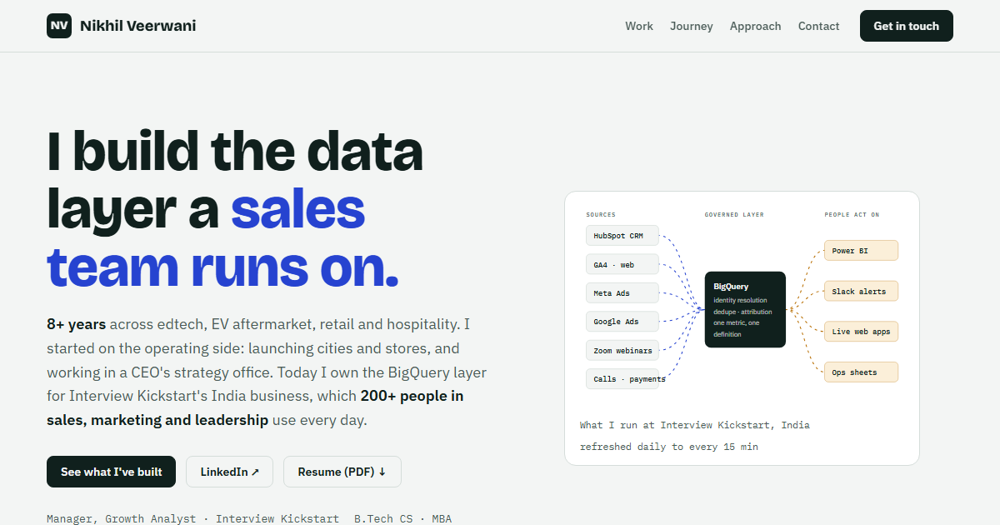

<div align="center">

# Nikhil Veerwani · Portfolio

**Analytics, BI & Growth · 8+ years · Bengaluru**

[](https://nikhilveerwani.github.io/)
[](https://www.linkedin.com/in/nikhil-veerwani)
[](https://nikhilveerwani.github.io/Nikhil_Veerwani_Resume.pdf)

<a href="https://nikhilveerwani.github.io/"></a>

</div>

## What's on the site

Case studies, each written as **problem → what I built → result**, across two halves of my career:

| Building data systems (2022 – now) | Launching and growing businesses (2017 – 2025) |
|---|---|
| A governed **BigQuery layer** used by 200+ sales, marketing and leadership users | Headed a **mechanic loyalty programme**: monthly active mechanics **3k → 8k**, revenue **+8% MoM** |
| An attribution fix that removed a **~45% overstatement** in one channel | Greaves Retail strategy team: Vahan market sizing, sell-in / sell-out, P&L, **₹10 Cr+** secondary sales |
| A reporting cycle cut from **3 hours to under a minute** | Category margins at Ebo Mart: **11% → 17%** Lighting, **3% → 5%** Wires |
| Slack lead-SLA alerts, live web consoles, an analytics request desk | Supermarket launches in **7 cities** in Rajasthan, the CEO's office at Miraj Group, Zoomcar's Udaipur launch |

## How it's built

- A **single HTML file**: no framework, no build step, no tracking.
- Light and dark themes follow the visitor's system setting.
- Responsive down to phone width, keyboard accessible, and printable.
- Project filters are plain JavaScript; the lineage diagram is inline SVG.
- Hosted free on **GitHub Pages**.

## Updating it

1. Edit `index.html`. Each project is one `<article class="case">` block, so copy one block to add a project.
2. Commit and push. GitHub Pages republishes within about a minute.

```
index.html                  the whole site
Nikhil_Veerwani_Resume.pdf  public resume (no phone number)
assets/preview.png          link-preview image for LinkedIn and WhatsApp
```

---

<sub>Content © 2026 Nikhil Veerwani. Numbers are resume-level; no confidential employer data is published here.</sub>
